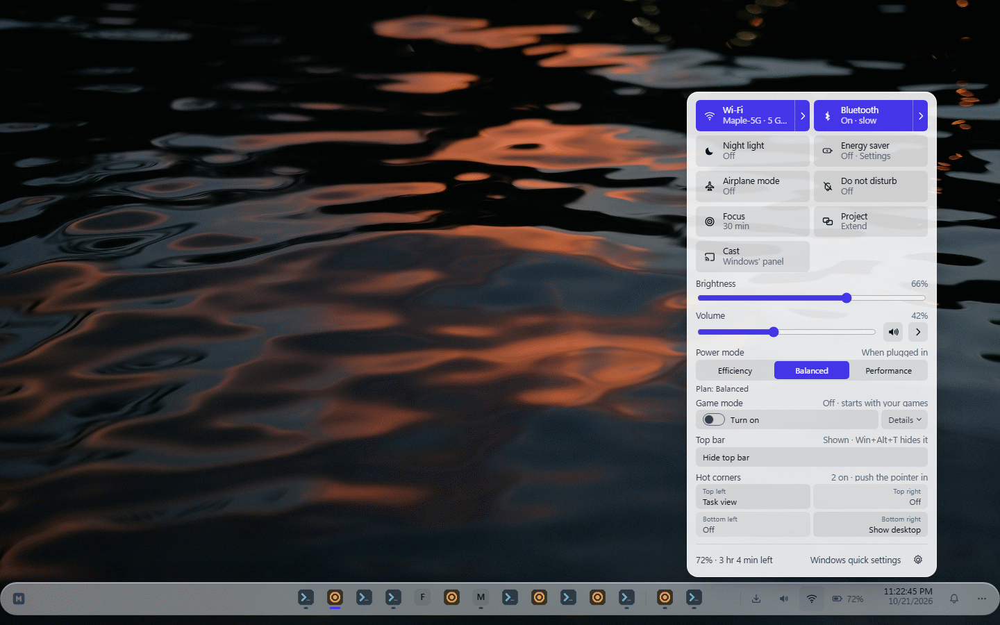

# Mantle

A shell layer for Windows 11: its own bar, launcher, desktop, notifications and system pop-ups,
drawn in Electron, with Explorer still running underneath so one keystroke, one tray click or one
crash puts Windows back exactly as it was.



<!-- TODO: add docs/screenshot.png, a real capture of the bar, the launcher and the desktop. -->

> **At your own risk.** Mantle takes over parts of the Windows shell (the taskbar, the Win key,
> Alt+Tab, notification banners, the desktop layer). It has been built and tested on one
> Windows 11 machine. Read the next section before your first live run, and keep it to hand.

## If the Windows taskbar disappears

Run this. It needs no Node, no Electron and no Mantle running:

```
powershell -NoProfile -ExecutionPolicy Bypass -File "<path to your Mantle checkout>\tools\restore-windows.ps1"
```

(or `npm run restore` from the repo). It stops Mantle — and only Mantle, never
another Electron app — puts the taskbar's auto-hide flag back to whatever it was
before Mantle started, resets the work area, checks that the taskbar is really
there, and prints `verified` before exiting 0. If it is still wrong, run it again
with `-RestartExplorer`.

**It is safe to run when nothing is wrong**: every step reads the current state
first and only writes when it differs.

If even that will not run: **Ctrl+Shift+Esc → find "Windows Explorer" → Restart**.

To stop a running Mantle cleanly from a script or another terminal:
`npm run quit` (`electron . --quit`) — it asks the running instance to put
Windows back and exit, and needs no keystroke and no tray click.

`electron .` on its own does **nothing** now. Live mode has to be asked for by
name: `npm run live`, or `electron . --live`. Live mode prints the recovery
command above, and the path of the file holding your original shell state, three
seconds before it touches anything.

### Why all of this exists

2026-09-21, the first live run: Mantle hid the `Shell_TrayWnd` window with
`ShowWindow(SW_HIDE)`. Owen's taskbar is set to **auto-hide**, and hiding the
window of an auto-hiding taskbar wedges explorer's own show/hide state machine —
`SW_SHOW` on the way out did not bring it back, and the PC had to be
**rebooted**.

Everything above follows from the rule that came out of it: **a killed Mantle
must leave Windows exactly as usable as before.** No shell state may need a
living process to undo. So Mantle now flips only the OS-managed auto-hide flag
(`ABM_SETSTATE`), which Windows itself owns; its bar is a **real app bar**, which
Explorer drops by itself the moment the window dies, instead of an
`SPI_SETWORKAREA` call that would outlive the process; the original state is
written to a file *before* anything changes; and the recovery script above reads
that file from outside.

---

A shell **layer** over Windows 11. explorer.exe keeps running underneath: Mantle
puts the Windows taskbar on auto-hide and puts its own bar, launcher and desktop
layer on screen in the instrument-glass look the browser uses. One keystroke, one
tray menu item or one crash puts Windows back exactly as it was.

Electron draws every pixel. One C# sidecar makes every Win32 call. Nothing else
talks to Windows.

```
  Electron (main.js)                        C# sidecar
  ├── bar        ui/bar/        44px        JSON lines over stdin/stdout
  ├── launcher   ui/launcher/   680x460     ├── window list / focus / close
  ├── desktop    ui/desktop/    full screen ├── the taskbar's auto-hide flag
  └── preload.js -> window.mantle           ├── the bar's app-bar registration
                                            ├── reparent the desktop under the wallpaper
                                            ├── the solo-Win-tap hook
                                            ├── volume + the notification area
                                            └── the shell-state file, written first
```

## Requirements

- **Windows 11** (developed on 25H2). Windows 10 is not supported.
- **Node.js 24** and npm. `npm install` brings Electron 44 and koffi.
- **.NET Framework 4.x**, which ships with Windows: the sidecar is compiled by the in-box
  `C:\Windows\Microsoft.NET\Framework64\v4.0.30319\csc.exe`. No .NET SDK and no Visual Studio needed.
- Optional: the Spotify desktop app (for the bar's Spotify controls), a Google Cloud project (for
  Google Calendar in the clock, see below), and playwright-core with its Chromium (only for the
  page tests and screenshot tools).

## Install

```
git clone https://github.com/Owen-Silva/mantle.git
cd mantle
npm install
npm run build:sidecar     # compiles sidecar\*.cs into sidecar\bin\Mantle.Sidecar.exe
npm test                  # test mode: the sidecar refuses every shell change, Windows untouched
npm run live              # the real thing: prints the recovery command, waits 3 s, then starts
```

To start Mantle at sign-in, `npm run autostart` registers a "Mantle" logon task
(`tools/mantle-logon-task.xml`) and starts it. To remove Mantle: `npm run autostart:remove`, then
`npm run quit` (or `npm run restore` if it is not running).

## Configure

Mantle's own settings live in its Settings window and in `%APPDATA%\mantle`. Nothing personal is
read from the repo.

**Google Calendar (optional): bring your own OAuth client.** Mantle shows your calendar in the
clock's flyout, read-only. It ships with no Google client ID, so each user registers their own:

1. In Google Cloud Console, create a project and enable the **Google Calendar API**.
2. Configure the OAuth consent screen with your own app name and **your own privacy-policy URL**,
   and add the scope `https://www.googleapis.com/auth/calendar.readonly`.
3. Create an OAuth client of type **Desktop app** and download its JSON file.
4. In Mantle Settings, Date & time, Google Calendar: **Choose Google client file…** (it opens
   Downloads), then **Sign in with Google**. The sign-in is a PKCE loopback flow in your browser.

While the consent screen is in **Testing** mode, only the test users you list can sign in, and
Google expires their sign-in after 7 days. Publishing it for anyone means Google's verification
for `calendar.readonly`, a sensitive scope; until then users see the "unverified app" screen. The
client file and the sign-in token are stored encrypted with Windows DPAPI (Electron safeStorage) in
`%APPDATA%\mantle\gcal`; signing out revokes the token and deletes it and the cache.

**Links.** http(s) links open in an Electron browser checked out at `%USERPROFILE%\browser` (the
author's Quartz) when that folder exists; set `MANTLE_BROWSER_DIR` to use another folder. Without
one, links go to the Windows default browser.

**Tests and tools.** The page tests and screenshot tools need playwright-core; other machine
paths (an optional CPU-cap module, ffmpeg/ffprobe, a scratch folder) come from environment
variables or `%USERPROFILE%\.mantle-dev.json`. See `tools/dev-env.js` for the keys.

**Spotify.** The bar's Spotify controls drive the Spotify desktop app through its local debugging
port and Spotify's own internal web API. That is unofficial and can break whenever Spotify
updates. Mantle is not affiliated with Spotify or Microsoft.

## How it works, and why it is built this way

- **A layer, not a replacement.** Mantle never replaces `explorer.exe` as the shell. It sets the
  taskbar's own auto-hide flag (`ABM_SETSTATE`), registers its bar as a real app bar and parents
  its desktop under the wallpaper window. Each of those is state Windows itself owns and cleans up
  when the window dies, so a crashed or killed Mantle cannot leave the PC unusable. The original
  state is written to a file *before* anything changes, and `tools/restore-windows.ps1` can put it
  back with no Node, no Electron and no Mantle.
- **Two processes, one job each.** Electron draws every pixel: HTML and CSS make the glass look,
  the animations and the many small surfaces quick to build. One C# sidecar makes every Win32 and
  WinRT call (window lists, focus, keyboard hooks, audio, media sessions, notifications) and talks
  to Electron in JSON lines over stdin/stdout. A slow or hung system call stalls the sidecar, not
  the UI; the sidecar can be restarted without restarting the shell, and a supervisor brings Mantle
  back after a crash (three crashes in two minutes and it gives up and restores Windows).
- **No toolchain to install.** The sidecar compiles with the C# compiler that ships with Windows,
  and reaches WinRT through the system's own metadata files, so a clone builds on a stock PC.
- **Nothing fails silently.** Every fallback shows its state and the reason on screen, and raw
  error codes become plain sentences (see "Nothing fails silently" below).
- **RAM first.** Settings, Task Manager, Files and the other windows open cold by default; nothing
  sits pre-loaded in the background unless you ask for it per surface.
- **Testable without touching Windows.** `--test` runs invisible windows against a passive sidecar
  that refuses every shell change. Features have plain-Node unit tests, page tests in headless
  Chromium, and Electron end-to-end tests; `node tools/run-suite.js` runs them all and judges each
  file by its summary line.

## Running it

```
npm install
npm run live              # LIVE: taskbar to auto-hide, bar becomes an app bar
npm start                 # prints how to run it and exits 2, touching nothing
npm test                  # test mode: three ordinary windows, Windows untouched
npm run shots             # test mode, capture the three windows, quit
npm run quit              # ask a running Mantle to put Windows back and stop
npm run restore           # put Windows back with no Mantle running at all
npm run check             # node --check everything + which lane files exist
npm run build:sidecar     # compile the sidecar with the in-box csc.exe
```

`npm start` is deliberately the safe one. Typing `electron .` to check that the
app still boots used to reach into the live shell; that is what cost a reboot.

Flags (`electron . <flags>`):

| flag | what it does |
| --- | --- |
| `--live` | **required** to run live. Without it and without `--test`, Mantle prints one line and exits 2 having touched nothing. With it, it prints the recovery command and the state-file path and waits 3 seconds before starting |
| `--quit` | ask the running instance to run its verified restore path and exit, then exit 0. Creates no window, spawns no sidecar, changes nothing. Exits 1 with a plain message when no instance is running |
| `--test` | test mode: the sidecar runs `--passive` and refuses every shell change; the three windows are plain resizable windows; nothing is hidden, hooked or reparented |
| `--profile-name=<x>` | **required with `--test`.** userData goes to `%TEMP%\mantle-test-<x>`, which also keys the single-instance lock, so a test run can never collide with the live shell. `tools/toback.ps1` and `tools/kill-test.ps1` match this flag |
| `--screenshot=<dir>` | test mode only: 4s after the windows load, capture `bar.png`, `launcher.png`, `desktop.png` into `<dir>`, then quit |
| `--bar-edge=top\|bottom` | which edge the bar sits on (default `bottom`) |
| `--no-desktop` | skip the desktop layer entirely |
| `--no-acrylic` | no blur-behind glass on the bar and launcher: plain transparent windows with whatever the pages paint in CSS |
| `--theme=dark\|light\|system` | test mode only: this instance's appearance over the saved setting (`lib/theme.js`), which it never reads for the mode or writes; `theme.set` still switches it live until it quits. `--theme=dark` is how a lane checks a surface in dark |

### Glass

The bar and the launcher are transparent windows that get a **Windows
blur-behind backdrop** from the sidecar's `glass` command
(`SetWindowCompositionAttribute`), so they blur what is genuinely behind them on
the desktop — something `backdrop-filter` cannot do, because CSS can only sample
pixels the page itself composites. It touches nothing but Mantle's own two
windows, so it is allowed in passive mode and runs in `--test` too.

**Do not "simplify" this to Electron's `backgroundMaterial: 'acrylic'`.** That
was tried first and reverted the same day. `backgroundMaterial` is DWM's *system
backdrop*, and Windows draws a system backdrop **only on the active window**. The
bar is `focusable: false` and is never active by design; the launcher is inactive
most of the time. Both showed the solid fallback nearly always. The API was doing
exactly what it documents, on two windows that can never satisfy it.

The desktop layer gets no glass — it sits *under* the wallpaper, so there is
nothing behind it to blur.

Which path was taken is in `state.glass` — `{ material: 'acrylic-blur-behind' |
'none', reason }` — and the desktop's *Needs attention* strip shows it whenever
it is not glass, whether that was `--no-acrylic`, a sidecar too old for the
command, or a refusal.

## Getting Windows back

Six ways. The first five run the same verified restore path — **app bar removed,
then the taskbar's auto-hide flag back to its original, then read back to
confirm** — and print one line saying so, or the failure and the recovery
command. The sixth needs nothing of Mantle to be working at all.

1. **Ctrl+Alt+Shift+Backspace** — the kill switch. Restores, then quits.
2. The **tray menu** (left or right click the icon) — *Put Windows back (keep Mantle open)*, or *Quit Mantle*.
   After *Put Windows back* Mantle is paused: it changes nothing of Windows' again, even if its
   link to Windows restarts, until *Restart Mantle to resume*.
3. `electron . --quit` / `npm run quit` from any terminal or script.
4. `mantle.call('shell.restore')` from any Mantle page (Mantle keeps running).
5. **Killing Mantle.** The sidecar watches its parent pid and its own stdin; when
   either goes away it restores everything itself before exiting, and says so
   with a `restore` event. If it exits without confirming, Mantle says *that*
   rather than assuming.
6. **`npm run restore`** — the standalone script at the top of this file. No
   Node, no Electron, no Mantle. This is the one that matters: nothing about
   getting Windows back depends on Mantle being alive or correct.

The restore path is idempotent and swallows every error. If a step fails it says
so in the state (see below) *and* prints the recovery command, rather than
throwing.

If Mantle starts and finds the state file marked `restored: false` — a previous
run died without putting Windows back — it runs the recovery script first,
synchronously, before it touches anything, and every reason in the state says
that it happened.

## Nothing fails silently

Every helper, poller and fallback carries a **reason in plain words**, and the
desktop layer prints every unhappy one in its *Needs attention* strip. A log line
does not count; if it is not on screen it did not happen.

The shape, pushed to every window on every change and readable with
`mantle.call('state.get')`:

```js
{
  mode:      'live' | 'test',
  edge:      'bottom' | 'top',                  // from --bar-edge; the bar flips its popovers on it
  sidecar:   { status: 'ok'|'starting'|'down', reason },
  taskbar:   { autohide, wasAutohide, hidden, reason },   // hidden mirrors autohide
  workarea:  { reserved, reason },                        // "the bar is a real app bar"
  desktop:   { attached, mode, reason },
  hotkey:    { winTap,   reason },
  tray:      { status: 'ok'|'unavailable', reason },
  glass:     { material: 'acrylic-blur-behind'|'none', reason },
  shortcuts: { killSwitch, launcher, reason }   // globalShortcut registration
}
```

A missing `ui/bar/index.html` or `ui/launcher/index.html` loads a placeholder
naming the file; a missing `lib/launcher-index.js` makes `apps.index` answer with
an empty list and a source row that says which lane owns it; a missing sidecar
exe is built once from `sidecar/build.ps1` and, if it still is not there, becomes
`sidecar: down` with the path in the reason while everything else keeps running.

## The tray menu

The first row says how Mantle is (*running normally*, *N things need a look*, *Paused*), with one
short line per cause under it; a link to Windows that gave up restarting gets *Reconnect Mantle to
Windows* right there. Then *Open launcher* (Alt+Space), *Open Mantle Settings* (Win+I), *Wallpapers…*,
*Features ▸* (every switch), *Copy diagnostic report*, *Restart Mantle*, *Put Windows back*, *Quit Mantle*
(Ctrl+Alt+Shift+Backspace).

**Copy diagnostic report** puts one paste on the clipboard: build, uptime, displays and scale,
memory, what Mantle says is wrong, the link to Windows, features, and the last 15 warnings. The user
name, PC name and home folder are left out (the same scrubber `--log` files get).

**After a crash** Mantle puts Windows back, writes `<userData>/crash.json`, and starts itself again the
way *Restart Mantle* does, at most 3 times in 10 minutes; it exits with code 1 so the logon task
records the failure. The next start says *Restarted by itself after an error at HH:MM* for an hour.

## The bridge

Pages run with `contextIsolation` and `sandbox` on — no `require`, no node.
`preload.js` exposes exactly one object, and main answers it only for pages loaded from `ui/`: no
Mantle window can navigate away from `ui/` or open a window of its own, `open` takes Windows Settings
pages and web links only, and a failed call's log line never repeats the caller's own words.

```js
mantle.call(name, args) -> Promise<result>   // rejects with an Error in plain words
mantle.on(event, cb)    -> unsubscribe()
```

| call | |
| --- | --- |
| `state.get` | the object above |
| `windows.list` | `[{hwnd, title, exe, pid, minimized, foreground, icon}]` |
| `win.focus` `win.minimize` `win.close` `win.toggle` | `{hwnd}` |
| `launcher.show` `launcher.hide` | |
| `bar.popover` | `{open, height, key}`: borrow up to 320px of extra window height so a popover is not clipped by the 44px bar. Grows away from the bar's screen edge; `{open:false}` gives it back |
| `apps.index` `apps.search` `apps.launch` | the launcher's index (`lib/launcher-index.js`) |
| `volume.get` `volume.set` | `{level, muted}` |
| `open` | `{target}`: `ms-settings:*` (Mantle Settings when it has the page), `ms-availablenetworks:`, or an http(s) link (see Links under Configure); anything else is refused. A --test run opens nothing |
| `sys.stats` | `{cpu, memUsed, memTotal, battery}` |
| `tray.list` `tray.click` | the Windows notification area, mirrored |
| `shell.restore` `shell.quit` `shell.restart` | restore pauses Mantle until a restart |
| `shell.reconnect` | start the link to Windows again after it gave up restarting |
| `diag.report` | `{text}`: the diagnostic report the tray copies |
| `net.probe` | `{url}` → `{ok, reason}`, loopback only (the desktop uses it for Mission Control) |
| `theme.get` | Mantle's own appearance: `{mode: 'system'\|'light'\|'dark', theme: 'light'\|'dark', windows, windowsWhy, pinned, note}`. `mode` is the setting (default `system` = Match Windows), `theme` what shows now, `windows` Windows' own app mode (null + `windowsWhy` when unknown), `pinned` set by `--theme` |
| `theme.set` | `{mode}`: switches every Mantle window at once, no reload, and saves it in `<userData>/theme.json`; answers as `theme.get` plus `value`, or `{ok:false, reason}` for anything that is not a mode. Fires the `theme` event |

Events: `windows`, `state`, `launcher:visible`, `tray`, `theme`. `windows`, `state` and `theme`
also fire once immediately on subscribe, so no page renders an empty first frame.

## Layout

```
main.js              flags, windows, IPC, sidecar lifetime, tray, kill switch, restore
preload.js           window.mantle, and nothing else
lib/args.js          flag parsing; refuses to boot on a flag that would be dangerous
lib/state.js         the state object above
lib/theme.js         Mantle's light / dark / Match Windows: the setting, Windows' app mode, the resolved theme
lib/sidecar.js       spawn, JSON lines, timeouts, restarts, the build-once attempt
lib/windows.js       the three windows, live shape and test shape
lib/apps.js          lane D's index module, wrapped so a missing one is a visible state
lib/sys-stats.js     cpu from os.cpus() deltas, memory, battery via one WMI probe
lib/tray-icon.js     the tray icon, drawn in code so the accent colour has one home
lib/placeholder.js   the "this file does not exist yet" page
lib/open-target.js   http(s) -> ~/browser or default, scheme: -> shell, path -> shell
lib/net-probe.js     loopback reachability with a real reason
ui/shared/tokens.css the palette. Every colour in Mantle comes from here
ui/bar/              the bar
ui/launcher/         the launcher
ui/desktop/          the desktop layer: clock, stats, Mission Control, state strip
sidecar/             the C# sidecar and its build script
tools/toback.ps1     send a test instance's windows to the back without activating them
tools/kill-test.ps1  stop ONE test instance by profile name (never `taskkill electron.exe`)
tools/restore-windows.ps1  put Windows back with no Node, no Electron, no Mantle
tools/check.js       node --check everything + a present/missing list of the lane files
```

## Testing rules

Test instances only, and always this way:

```
npx electron . --test --profile-name=mainlane [--screenshot=<dir>]
powershell -NoProfile -File tools/toback.ps1 -Match mainlane      # immediately after
powershell -NoProfile -File tools/kill-test.ps1 -Match mainlane   # to stop it
```

`--profile-name` is what both scripts match, as the whole flag. Never
`taskkill electron.exe`: other apps (browsers, editors) are Electron apps too.

## Licence

Mantle is free software under the **GNU General Public License v3.0** (`LICENSE`).

Not covered by the GPL: the wallpaper photos in `assets/backgrounds/` are under the Unsplash
License (`assets/backgrounds/CREDITS.md`), and the emoji data is built from Unicode data under the
Unicode License v3 (`ui/emoji/DATA-LICENSE.txt`). See `CREDITS.md`.

## Contributing

Issues are welcome. Pull requests are not accepted right now.
